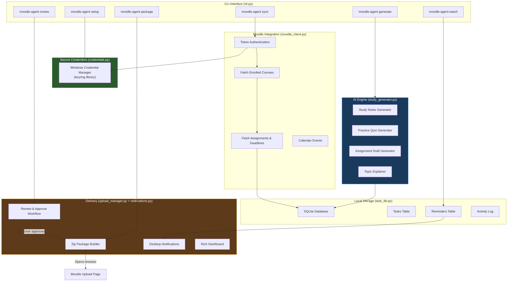
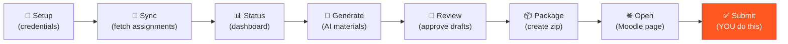

# 📚 Moodle Assignment Agent — Project Overview

## Architecture



## Module Map

| Module | Purpose | Key Classes/Functions |
|--------|---------|----------------------|
| [`config.py`](file:///d:/My%20personal%20projects/Agents/Assignment%20doing%20Agent/moodle_agent/config.py) | Constants, paths, model config | `DATA_DIR`, `GEMINI_MODEL`, `DATABASE_PATH` |
| [`credentials.py`](file:///d:/My%20personal%20projects/Agents/Assignment%20doing%20Agent/moodle_agent/credentials.py) | Secure credential storage | `store_credentials()`, `get_token()`, `interactive_setup()` |
| [`moodle_client.py`](file:///d:/My%20personal%20projects/Agents/Assignment%20doing%20Agent/moodle_agent/moodle_client.py) | Moodle REST API client | `MoodleClient`, `Assignment` dataclass |
| [`task_db.py`](file:///d:/My%20personal%20projects/Agents/Assignment%20doing%20Agent/moodle_agent/task_db.py) | SQLite task/reminder database | `TaskDatabase`, `TaskRecord`, `TaskStatus` |
| [`study_generator.py`](file:///d:/My%20personal%20projects/Agents/Assignment%20doing%20Agent/moodle_agent/study_generator.py) | AI-powered study materials | `generate_study_notes()`, `generate_practice_quiz()`, `generate_assignment_draft()` |
| [`upload_manager.py`](file:///d:/My%20personal%20projects/Agents/Assignment%20doing%20Agent/moodle_agent/upload_manager.py) | Zip packaging & review workflow | `prepare_upload_package()`, `review_and_approve()` |
| [`notifications.py`](file:///d:/My%20personal%20projects/Agents/Assignment%20doing%20Agent/moodle_agent/notifications.py) | Reminders & dashboard | `send_desktop_notification()`, `display_task_dashboard()` |
| [`cli.py`](file:///d:/My%20personal%20projects/Agents/Assignment%20doing%20Agent/moodle_agent/cli.py) | CLI entry point | `main()`, all `_cmd_*` handlers |

## Security Design

| Concern | Solution |
|---------|----------|
| Password storage | **Windows Credential Manager** via `keyring` — encrypted at OS level |
| API tokens | Stored in keyring, never written to files |
| Gemini API key | Stored in keyring, prompted with hidden input (`getpass`) |
| No auto-submission | All uploads require explicit user approval via interactive review |
| Credential cleanup | `moodle-agent clear-credentials` wipes all stored secrets |

> [!IMPORTANT]
> **No passwords, tokens, or API keys are ever stored in plain text** — not in config files, environment variables, or the database. Everything goes through the OS-level keyring.

## Quick Start

```bash
# 1. Install
cd "d:\My personal projects\Agents\Assignment doing Agent"
pip install -e .

# 2. Configure credentials (stored in Windows Credential Manager)
moodle-agent setup

# 3. Fetch assignments from Moodle
moodle-agent sync

# 4. View your assignment dashboard
moodle-agent status

# 5. Generate study materials for task #1
moodle-agent generate 1

# 6. Review and approve before submission
moodle-agent review

# 7. Start watch mode for continuous monitoring
moodle-agent watch
```

## All Commands

| Command | Description |
|---------|-------------|
| `setup` | Configure Moodle URL, username, password & Gemini API key |
| `sync --days 30` | Fetch upcoming assignments from Moodle |
| `list [--status pending]` | List tracked assignments, optionally filtered |
| `status` | Show full dashboard with urgency indicators |
| `detail <id>` | Show detailed info for a specific task |
| `generate <id> [--type all\|notes\|quiz\|draft]` | Generate AI study materials |
| `generate-all` | Generate materials for all pending tasks |
| `review [id]` | Interactive review and approval workflow |
| `package <id> [--files ...]` | Create zip upload package |
| `explain "topic" [--level detailed]` | Get an AI explanation of any topic |
| `watch --interval 3600` | Monitor mode: auto-sync + reminders |
| `open <id>` | Open Moodle submission page in browser |
| `clear-credentials` | Remove all stored credentials |

## Workflow



> [!CAUTION]
> The agent **never auto-submits** to Moodle. Step 8 (Submit) is always done by **you** in the browser. The agent prepares everything and opens the page — you make the final call.

## Prerequisites

Before using this agent, your Moodle instance needs:

1. **Web Services enabled** — Site Administration → Advanced Features → Enable web services
2. **REST protocol enabled** — Site Administration → Plugins → Web services → Manage protocols
3. **Mobile app service** — Must be enabled (used for token authentication)
4. **User permissions** — Your account needs `mod/assign:view` capability
